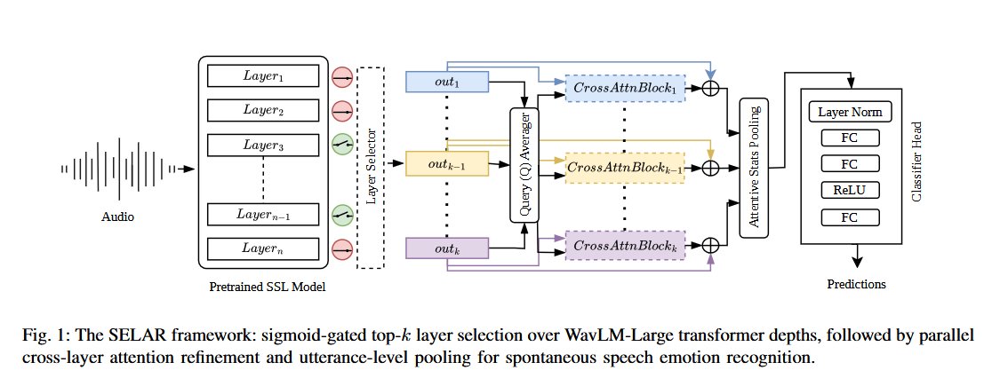

<div align="center">

# SELAR

### Selective Emotion-Layer Attention Refinement for Spontaneous Speech Emotion Recognition


Drishya Uniyal · Vinayak Abrol  
Department of Computer Science, CAI, IIIT-Delhi, New Delhi, India

*Learn which speech-encoder layers matter for emotion—and how to fuse them.*

[Overview](#overview) · [Architecture](#architecture) · [Results](#reported-results) · [Getting started](#getting-started) · [Training](#training) · [Citation](#citation)

</div>

---

## Overview

Emotion cues are not distributed uniformly across the layers of a self-supervised speech encoder. Using only the final layer or combining every layer without explicitly modeling their interactions can leave useful affective information unexploited.

SELAR combines learnable layer selection with cross-layer attention to recognize emotions in spontaneous speech. Built on WavLM-Large, the framework selects a subset of transformer-layer representations, refines them using a shared query, and produces utterance-level emotion predictions using attentive statistics pooling.

The paper evaluates SELAR on MSP-Podcast v2.0, including both labeled open test partitions, Test1 and Test2.

### At a glance

- Learnable selection: sigmoid-gated, score-weighted top-k selection over 24 transformer layers.
- Cross-layer refinement: parallel attention branches with a query aggregated from the selected representations.
- Utterance modeling: attentive statistics pooling followed by an emotion-classification head.
- Imbalance-aware learning: the paper describes class-weighted focal loss and label smoothing.
- Best reported selection size: 9 of 24 layers.
- Eight target emotions: Anger, Contempt, Disgust, Fear, Happiness, Neutral, Sadness, and Surprise.

## Architecture

<!-- Add the paper's Figure 1 as assets/architecture.png before publishing. -->
<p align="center">
  
</p>

```text
Audio waveform
      │
      ▼
WavLM-Large: 24 transformer-layer representations
      │
      ▼
Sigmoid-gated top-k layer selection
      │
      ├── Mean of selected, score-weighted states → shared query
      │
      ▼
Parallel cross-attention + layer-specific residual connections
      │
      ▼
Sum of refined representations
      │
      ▼
Attentive statistics pooling → classifier → emotion prediction
```

Each selected layer supplies its own keys and values to a cross-attention branch. The shared query incorporates information from the selected set, allowing each branch to refine its representation before fusion.

## Reported results

The following values are reported in the paper for SELAR with k = 9 on MSP-Podcast v2.0. 

| Partition | WAR ↑ | UAR ↑ | F1-macro ↑ | F1-micro ↑ |
|:----------|------:|------:|-----------:|-----------:|
| Test1 | 0.630 | 0.396 | 0.341 | 0.612 |
| Test2 | 0.650 | 0.292 | 0.257 | 0.626 |

Relative to the WavLM-Large baseline in the paper, UAR improves by 8.1 percentage points on Test1 and 5.7 percentage points on Test2. The paper reports averages over three independent random seeds.

## Getting started

### 1. Obtain the code

Clone this repository and run the commands below from its root directory.

### 2. Prepare the environment

Install a CUDA-compatible PyTorch and torchaudio build for your environment, then install the additional packages directly imported by the entry-point script:

```bash
pip install pandas PyYAML scikit-learn
```

This is not a complete, version-pinned dependency specification. The local `MSP_SER` modules may require additional libraries; install their dependencies as well. The supplied entry point uses CUDA directly and does not include a CPU fallback.

### 3. Check the required project modules

The training entry point imports the following local components:

| Module | Required components | Purpose |
|:-------|:--------------------|:--------|
| `MSP_SER.dataset` | `MSP2_Dataset` | Dataset loading and split handling |
| `MSP_SER.architectures` | `WavLMLayerWeighted`, `ProjectionNetwork` | Feature extraction and classification |
| `MSP_SER.criterion` | `WeightedFocalLoss` | Training objective |
| `MSP_SER.utilities` | `GetYAMLConfigs`, `Logs` | Configuration, logging, and output directories |

These modules must be included in the repository and importable from the environment. Their implementations were not part of the supplied entry-point file.

### 4. Prepare MSP-Podcast v2.0

Obtain the corpus separately under its access conditions. Configure the audio paths, annotations, partition handling, and label mapping in `MSP_SER.dataset`.

The paper uses eight primary emotion categories and excludes `Other` and `No agreement`. Confirm that your dataset implementation applies the same filtering.

The Test3 export block in the supplied script also contains two machine-specific paths that must be changed:

```python
# Replace with your own dataset locations.
"/Partitions.txt"
"/Audios"
```

### 5. Create a configuration

Save a YAML configuration such as `configs/selar.yaml`. The following example contains the keys accessed directly by the supplied entry point:

```yaml
experiment_name: selar_wavlm_k9
cuda_device: 0
seed: 42

BATCH_SIZE: 2
accumulation_steps: 8
epochs: 20

learning_rate: 0.0001
minibatch_log_after: 50
compute_test_scores_after: 1
```

The batch size, seed, epoch count, accumulation count, and logging intervals above are illustrative—not a verified paper configuration. The local configuration and dataset utilities may require additional settings.

The entry point uses `learning_rate * 0.1` for the feature extractor and `learning_rate` for the projection network. With the example above, these are 1e-5 and 1e-4, respectively. Check the architecture implementation if selector and attention parameters require separate optimizer groups.

## Training

### Select the number of layers

To use the paper's best reported selection size, change this line to:
```python
feature_extractor = WavLMLayerWeighted(k=9).to(DEVICE)
```

Changing the experiment name in YAML does not change k. The script does not currently expose a `--k` command-line argument.

### Launch an experiment

```bash
python selar.py --config configs/selar.yaml
```

The entry point performs:

1. Training with weighted focal loss, mixed precision, and gradient accumulation.
2. Gradient clipping with maximum norm 1.0.
3. AdamW optimization and cosine-annealing scheduling.
4. Development-set evaluation after every epoch.
5. Checkpoint saving after every epoch.
6. Test1 and Test2 evaluation at the configured interval.
7. Test3 prediction export after training.

### Outputs

Output directories are determined by the local `Logs` utility. The script writes:

| Output | Contents |
|:-------|:---------|
| Experiment logs | Training loss, accuracy, and development/test metrics |
| `epoch_<e>.pt` | Feature-extractor and projection-network state dictionaries |
| `test3_predictions.csv` | `FileName` and predicted `EmoClass` columns |

The checkpoints do not include optimizer, scheduler, or gradient-scaler states. The supplied script has no standalone evaluation or resume-training command.

## Reproduction checklist

Before comparing an experiment with the paper:

- Verify that `WavLMLayerWeighted` implements the intended selection, gradient estimator, cross-attention, and pooling.
- Set k = 9 for the best reported configuration.
- Match the backbone fine-tuning/freezing policy used for the reported run.
- Verify class weights and label smoothing inside `WeightedFocalLoss`; they are not explicitly configured in the entry point.
- Match dataset filtering, audio preprocessing, and class ordering.
- Use development-set performance—not test-set scores—to select checkpoints and hyperparameters.
- Repeat experiments across the three intended seeds and aggregate results consistently.
- Resolve the metric-definition discrepancy noted above before claiming exact reproduction.

### Implementation notes

- Mixed precision: the training loop passes an indexed device string to `autocast`. Check compatibility with your PyTorch version; the development/test loops use `device_type="cuda"`.
- Test3 batching: the export block stacks waveforms loaded with `full_audio=True`. If their lengths differ, batching needs padding, a fixed-length preprocessing policy, or single-item batches.
- Test3 preprocessing: the current loader repeats each waveform before the `full_audio` branch. Verify that this matches your intended inference policy.
- Scheduling: `CosineAnnealingLR` uses a hard-coded `T_max=9`; check this against the intended training schedule.

## Citation

If you use this work, please cite the SELAR paper. This provisional entry intentionally omits publication details that have not yet been supplied; replace it with the official proceedings entry when available.

```bibtex
@inproceedings{uniyal_selar,
  title     = {SELAR: Selective Emotion-Layer Attention Refinement for Spontaneous Speech Emotion Recognition},
  author    = {Uniyal, Drishya and Abrol, Vinayak},
  booktitle = {IEEE Spoken Language Technology Workshop (SLT)},
  note      = {Accepted for publication}
}
```

## Contact

For questions about the paper or implementation:

- Drishya Uniyal: drishyau@iiitd.ac.in
- Vinayak Abrol: abrol@iiitd.ac.in

<!-- Before publishing: add the architecture asset, the public paper link, the
repository's tested dependency versions, complete configs and local modules,
and a license chosen by the authors. Update the citation with official metadata. -->
